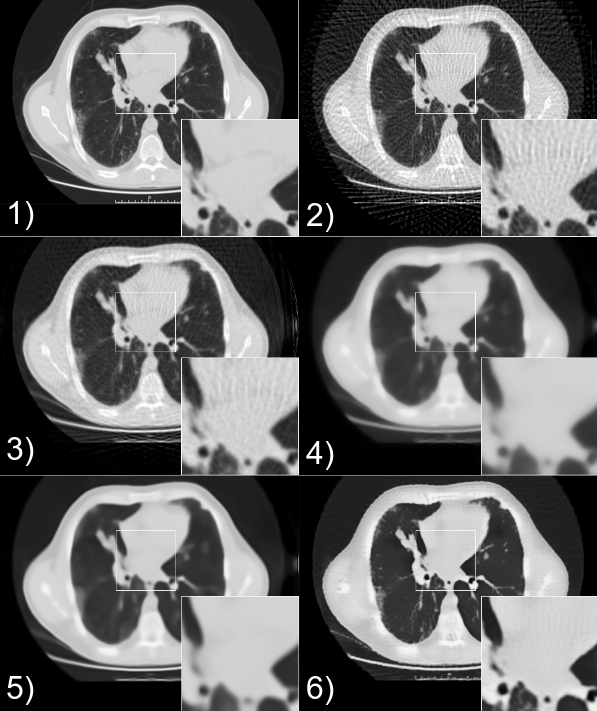

# SparseCT | Proj2Proj

**The proposed method in this repository is Proj2Proj**, a self-supervised method
for low-dose CT reconstruction. It trains an image reconstruction network using
only noisy projections, without paired normal-dose targets.

[Paper](https://doi.org/10.7717/peerj-cs.1849) | [Open access full text](https://pmc.ncbi.nlm.nih.gov/articles/PMC10909204/) | [Implementation](sparse_ct/reconstructor_2d/proj2proj.py) | [Example](sparse_ct/example/proj2proj_example.py)

## Citation

```bibtex
@article{unal2024proj2proj,
  title={Proj2Proj: self-supervised low-dose CT reconstruction},
  author={Unal, Mehmet Ozan and Ertas, Metin and Yildirim, Isa},
  journal={PeerJ Computer Science},
  volume={10},
  pages={e1849},
  year={2024},
  publisher={PeerJ Inc.}
}
```

Proj2Proj perturbs a subset of sinogram pixels on a 4 x 4 grid, reconstructs the
masked projections with filtered backprojection (FBP), denoises the image with a
CNN, and forward projects the result. The loss compares only the held-out
projection pixels. At inference, the network receives FBP of the full sinogram.
The default network is U-Net. The original weighted neighbor interpolation and
masked MSE scaling are retained.

## Which method is which?

| Method | Implementation | Role |
| :--- | :--- | :--- |
| **Proj2Proj** | [`Proj2ProjReconstructor`](sparse_ct/reconstructor_2d/proj2proj.py) | **Proposed method, PeerJ Computer Science 2024** |
| `N2SelfReconstructor` | [`n2self.py`](sparse_ct/reconstructor_2d/n2self.py) | Compatibility wrapper for the old Proj2Proj name, not a separate baseline |
| Angle split experiment | [`n2selfS.py`](sparse_ct/reconstructor_2d/n2selfS.py) | Historical alternate implementation, not the canonical Proj2Proj method |
| DGR / deep generative prior | [`dgr.py`](sparse_ct/reconstructor_2d/dgr.py) | Separate unsupervised method and related paper |
| FBP + CNN, supervised | [`supervised.py`](sparse_ct/reconstructor_2d/supervised.py) | Baseline requiring reference targets |
| FBP, SART, TV, BM3D | [`analytic.py`](sparse_ct/reconstructor_2d/analytic.py), [`iterative.py`](sparse_ct/reconstructor_2d/iterative.py) | Conventional baselines |

The name Noise2Self refers to the masking principle used by Proj2Proj. Older
scripts used N2Self as a working name. New scripts should use Proj2Proj.

## Installation

Use Python 3.10 or newer in a virtual environment. Install the PyTorch build
appropriate for your CPU or CUDA setup, then install this checkout:

```bash
python -m venv .venv
source .venv/bin/activate
python -m pip install -e .
```

`pip install -r requirements.txt` installs the same package. Dependencies and
package metadata are maintained in `pyproject.toml`. The differentiable Radon
backend is pinned to a specific Git commit; Git is required during installation.
Proj2Proj supplies filters using `torch.fft` for current PyTorch versions.
It selects CUDA when available, otherwise CPU; use `device="cpu"` to override.

Historical comparison methods and DIVAL ellipses generation have extra dependencies:

```bash
python -m pip install -e '.[legacy]'
```

These extras make the historical code available, but do not establish modern
PyTorch compatibility for every old experiment. `requirements-legacy.txt` and
`requirements-dump.txt` preserve the old environment records; they are not the
recommended installation. The original setup targeted Ubuntu 18.04 and PyTorch 1.4.

## Run Proj2Proj

A small CPU smoke run uses the bundled CT image and needs no downloaded data or
checkpoint:

```bash
python -m sparse_ct.example.proj2proj_example \
    --device cpu --net dncnn --size 32 --views 8 --iterations 2
```

This verifies execution only. For the original image and projection dimensions:

```bash
python -m sparse_ct.example.proj2proj_example --size 512 --views 64 --iterations 4000
```

The output defaults to `results/proj2proj.png` (ground truth, FBP, Proj2Proj) and
`results/proj2proj.npy`. Iteration count is configurable; these commands do not
reproduce the paper's dataset training or reported metrics. Ground truth is used
only for the displayed evaluation, never for the self-supervised loss.

To run a trained checkpoint, select the same network architecture used to train it:

```bash
python -m sparse_ct.example.proj2proj_example \
    --weights checkpoints/proj2proj.pth --inference-only
```

No pretrained checkpoint is included. Without `--inference-only`, supplied weights
are used as the starting point for further self-supervised adaptation.

## Python API

```python
import numpy as np
from sparse_ct.reconstructor_2d import Proj2ProjReconstructor

angles = np.linspace(0, 180, 64, endpoint=False)  # degrees
reconstructor = Proj2ProjReconstructor(
    net="unet",
    n_iter=4000,
    image_size=512,
    device="cuda",
)
image = reconstructor.calc(sinogram, angles)  # sinogram shape: (512, 64)
```

`calc` initializes a fresh network on each call, optionally loads `weights`, and
returns a clipped image in [0, 1]. Set `self_supervised=False` with trained weights
for inference. Ground truth and a log directory are optional, and are unnecessary
for reconstruction. Calling `set_for_metric` enables periodic image metrics.

## Dataset training

Use separate training and validation directories containing PNG CT slices:

```bash
python -m sparse_ct.example.proj2proj_train \
    --train-dir /path/to/train --validation-dir /path/to/validation \
    --epochs 10 --batch-size 8 --output checkpoints/proj2proj.pth
```

The loader creates noisy 64-view projections from each image. Training consumes
only the projections; validation uses reference images for metrics. The example
uses 512 x 512 images and U-Net. For measured sinograms, provide your own
`DataLoader` of float tensors shaped `(batch, 1, detectors, angles)`, call
`init_train(angles)`, then `train(train_loader, validation_loader, epochs=10)`.
Validation is optional.

## Migration and historical experiments

Old imports and `n2self_` constructor arguments remain available through
`N2SelfReconstructor`, with a deprecation warning. See the
[migration notes](docs/migration.md) for the option mapping and behavior fixes.
The `n2self_example` and `n2self_train` module paths forward to the new examples.

The [historical paper scripts](papers/README.md) retain their original names and
checkpoint paths. They are research records and may require local datasets and
older dependencies. The preview below comes from the 2021 ISBI study, which
preceded the 2024 Proj2Proj article:



## Development

```bash
python -m pip install -e '.[dev]'
python -m pytest
python -m build
```

Tests cover modern FFT filters, all 16 mask phases, CPU reconstruction,
checkpoint loading, optional metrics, and validation without parameter updates.
Historical experiments and full paper result reproduction are outside this suite.
New reconstructors should implement `calc(projections, angles)` and store the
output in `image_r`, following the shared `Reconstructor` interface.

## Related papers

### Self-Supervised Training For Low Dose CT Reconstruction

- [Click here to access the paper](https://ieeexplore.ieee.org/abstract/document/9433944)

```
@INPROCEEDINGS{9433944,
  author={Unal, Mehmet Ozan and Ertas, Metin and Yildirim, Isa},
  booktitle={2021 IEEE 18th International Symposium on Biomedical Imaging (ISBI)}, 
  title={Self-Supervised Training For Low-Dose Ct Reconstruction}, 
  year={2021},
  volume={},
  number={},
  pages={69-72},
  doi={10.1109/ISBI48211.2021.9433944}}
```

### An Unsupervised Reconstruction Method For Low-Dose CT Using Deep Generative Regularization Prior

- [Click here to access the paper](https://www.sciencedirect.com/science/article/pii/S1746809422001203)

```
@article{unal2020unsupervised,
  title={An Unsupervised Reconstruction Method For Low-Dose CT Using Deep Generative Regularization Prior},
  author={Unal, Mehmet Ozan and Ertas, Metin and Yildirim, Isa},
  journal={Biomedical Signal Processing and Control},
  volume={75},
  number={1746-8094},
  pages={103598},
  year={2020},
  publisher={Elsevier}
}
```

## Acknowledgements

The implementation builds on [Noise2Self](https://github.com/czbiohub/noise2self),
[Deep Image Prior](https://github.com/DmitryUlyanov/deep-image-prior), and
[PyTorch Radon](https://github.com/mozanunal/pytorch_radon). Attribution notices
are retained in the corresponding source files.

## License

See [LICENSE](LICENSE) and the attribution notices in reused source files.
